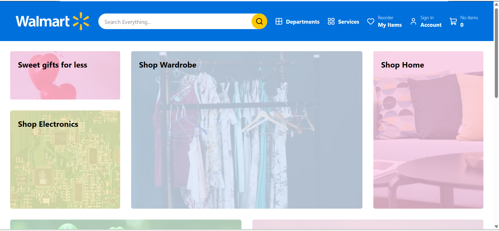

# Walmart Clone

A responsive e-commerce storefront built with Next.js, TypeScript and Tailwind CSS.



🔗 **Live demo:** [walmart-clone-lovat.vercel.app](https://walmart-clone-lovat.vercel.app/)

## ✨ Features

- Product listing and search
- Shopping basket with live cart total
- Responsive layout for mobile, tablet and desktop
- Optimised product images

## 🛠️ Tech Stack


## 🚀 Getting Started

First, install the dependencies and run the development server:

```bash
npm install
npm run dev
```

Open [http://localhost:3000](http://localhost:3000) in your browser to see the result.

You can start editing the page by modifying `app/page.tsx`. The page auto-updates as you edit the file.

## 🔐 Environment Variables

Create a `.env.local` file in the root folder and add your own keys:

```
YOUR_API_KEY=your_key_here
```

## 📚 Learn More

- [Next.js Documentation](https://nextjs.org/docs): Next.js features and API
- [Learn Next.js](https://nextjs.org/learn): an interactive Next.js tutorial

## 👤 Author

**Moses Yogo** · Front-End Developer
[LinkedIn](https://www.linkedin.com/in/moses-yogo) · [GitHub](https://github.com/mosesyogo)